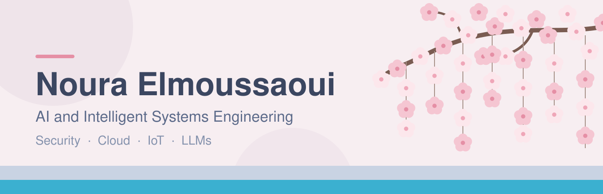

  

  

  
  
  

---

### 👩‍💻 About me

- 🎓 Final-year Master's student in **Intelligent Systems Engineering** (Cloud, Networks & Security) at Université Hassan II – Casablanca
- 🔐 Currently working on **protecting AI agents from prompt-injection attacks** (my M2 project)
- 🤖 I build complete systems that combine **backend, LLMs, machine learning and IoT**
- 🌱 Learning: Ethical Hacking (Cisco), agentic AI, cloud security
- 🎯 Open to PFE internship opportunities (2027)
- ⚡ Fun fact: I play chess and I'm learning Korean 🇰🇷

---

### 📫 Connect with me

  
  

---

### 🛠️ Languages and Tools

   
   
   
   
  

**AI & Data:** LLMs · Ollama · Hugging Face · RAG · Qdrant · Machine Learning
**IoT & Embedded:** ESP32 / ESP32-CAM · MQTT · Sensors & actuators

---

### 🚀 Featured Projects

<!-- Replace each REPO_NAME_HERE with your real repository name -->
<table>
  <tr>
    <td>
      
    </td>
    <td>
      
    </td>
  </tr>
  <tr>
    <td>
      
    </td>
    <td>
      
    </td>
  </tr>
</table>

| Project | What it does | Stack |
|---|---|---|
| 🛡️ **ML Defense Against AI Agent Hijacking** *(M2, in progress)* | A security layer between an AI agent and its tools that detects and blocks prompt-injection attacks before the agent acts | Python · ML · LLMs · Ollama |
| 🌾 **FarmShield** *(team of 3)* | Smart farm security: detects intrusions, water diversion and theft, reacts on the spot and alerts the farmer's phone in seconds | ESP32 · Python · MQTT · TensorFlow Lite · Node.js · React Native |
| 📄 **Rule-Based Document Analysis with an LLM** *(PFE Licence)* | Upload documents, define business rules once, get structured compliance answers powered by an LLM | Spring Boot · PostgreSQL · Elasticsearch · Kafka · Hugging Face |
| 🏥 **Coravita Clinic Chatbot** | Local LLM + RAG chatbot so clinic staff and patients can query protocols with no data leaving the clinic | Python · Ollama · Qdrant · RAG |
| ♟️ **TACTIX // BLACKBOX** | Strategic game AI with several difficulty levels, threat detection and a stats dashboard | Python · Minimax · Alpha-Beta · SQLite |

---

### 📊 GitHub Stats

  
  

  

  

---

  <i>Thanks for stopping by! Feel free to reach out if you'd like to talk about AI security, LLMs or cloud. 🚀</i>

  

